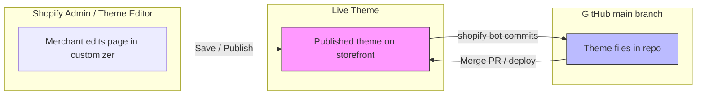
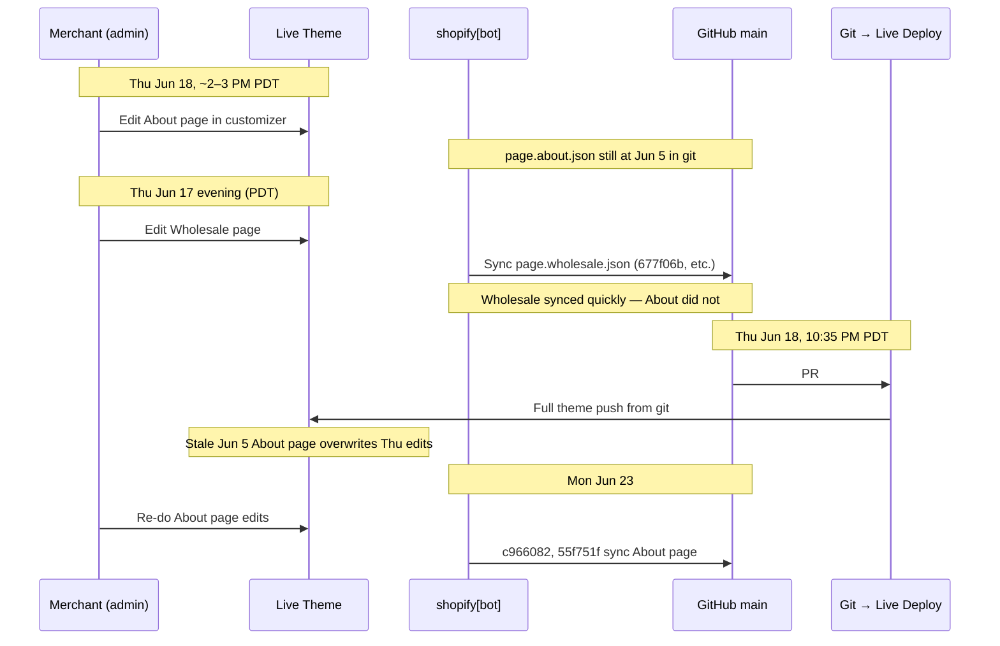

# Shopify Theme Overwrite Investigation

**Repository:** `wlcr/caffe-umbria-2026`  
**Store:** `caffeumbria.myshopify.com`  
**Investigation date:** June 2026  
**Status:** Root cause identified; workflow recommendations documented

---

## TL;DR

Customizer edits made in the Shopify admin **do not instantly appear in git**. The GitHub integration creates a **two-way sync loop**:

1. **Admin → Git:** `shopify[bot]` commits customizer changes to `main` (often delayed, file-by-file).
2. **Git → Live:** Every merge/deploy to `main` pushes the **entire theme** from git to the live store.

If you merge a dev branch while git is **behind** the live customizer, the deploy **overwrites live-only edits** with stale git content — even when your PR never touched those files.

**The June 18 About page incident:** Thursday afternoon About page edits lived only on Shopify live. Git’s last `page.about.json` sync was **June 5**. PR #40 merged Thursday night (~10:35 PM PDT) and deployed the full theme, pushing the **June 5** About page back to live. The bot did not sync Thursday’s About edits until **June 23**.

**Bottom line:** Before merging to `main`, confirm `shopify[bot]` has committed any recent customizer work for the files you care about. Never assume live and git are in sync.

---

## How the Sync Loop Works



| Direction | Trigger | What happens | Risk |
|-----------|---------|--------------|------|
| **Admin → Git** | Save in theme editor / customizer | `shopify[bot]` opens commit on `main` | Delayed; not all files sync at once; easy to miss in git log |
| **Git → Live** | Merge PR to `main`, push | Full theme deploy from git to connected live theme | **Overwrites** any live content not yet in git |
| **Local pull** | `npm run pull` (`shopify theme pull --live`) | Overwrites local files with live theme | Can clobber uncommitted local work |

---

## Repository Statistics

| Metric | Value |
|--------|-------|
| Total commits on `main` | ~1,494 |
| `shopify[bot]` commits | **1,251** (~84% of history) |
| Human dev commits (Jumpybuns + Ethan Pierce + ashearer) | ~236 |
| Connected theme branch | `caffe-umbria-2026/main` |

### Top commit authors

| Author | Commits |
|--------|---------|
| `shopify[bot]` | 1,251 |
| Jumpybuns | 173 |
| Ethan Pierce | 50 |
| ashearer | 13 |

### `shopify[bot]` activity (recent sample)

| Date | Bot commits |
|------|-------------|
| 2026-05-19 | 12 |
| 2026-05-22 | 13 |
| 2026-05-29 | 11 |
| 2026-06-05 | 7 |
| 2026-06-17 | 6 |
| 2026-06-19 | 9 |
| 2026-06-23 | 4 |

Bot commits are frequent but **bursty and file-specific** — syncing one template does not mean all customizer work is in git.

---

## Case Study: About Page (`templates/page.about.json`)

### The git gap (smoking gun)

`page.about.json` is auto-generated by the theme editor. Its header warns:

```
IMPORTANT: The contents of this file are auto-generated.
This file may be updated by the Shopify admin theme editor
or related systems. Please exercise caution as any changes
made to this file may be overwritten.
```

**Git blame** on the file header shows the original file creation by `shopify[bot]` on **2025-12-12** (`debddaa`).

### `page.about.json` commit timeline (June 2026)

| Date (UTC) | Commit | Author | Notes |
|------------|--------|--------|-------|
| 2026-06-05 20:55 | `7dc3c96` | shopify[bot] | **Last sync before incident** |
| 2026-06-05 → 2026-06-23 | — | — | **18-day gap — no git commits for this file** |
| 2026-06-18 ~14:00–15:00 PDT | — | — | **About page edited in admin (live only)** |
| 2026-06-18 22:35 PDT | `dbab13e` | Ethan Pierce | PR #40 merged — full theme deploy |
| 2026-06-23 18:00 | `c966082` | shopify[bot] | First bot sync of About edits after re-work |
| 2026-06-23 21:21 | `55f751f` | shopify[bot] | Follow-up About page sync |

At merge time (`dbab13e`), `page.about.json` in git was **byte-identical in size** to the June 5 version (1,379 lines). Thursday’s live edits were never in git when the deploy ran.

### Sample diff: what the bot finally synced (June 23)

Commit `c966082` — changes that had been live-only for days:

```diff
-        "overlay_color": "#e9d6652a",
+        "overlay_color": "#e9d66529",
...
+      "disabled": true,    // Notes anchor
+      "disabled": true,    // Notes section
+      "disabled": true,    // History anchor
+      "disabled": true,    // History section
+      "disabled": true,    // Community anchor
```

These `disabled: true` flags and overlay tweaks were the kind of customizer work that existed on live but not in git during the gap.

---

## Case Study: June 18–19 Incident Timeline



### Key events table

| Time (PDT) | Event | `page.about.json` in git? | `page.wholesale.json` in git? |
|------------|-------|---------------------------|--------------------------------|
| Jun 5, ~1:55 PM | Last bot sync of About | ✅ Current (then) | — |
| Jun 17, ~1:55–4:17 PM | Wholesale customizer edits | ❌ Stale (Jun 5) | ✅ Syncing same evening |
| Jun 18, ~2–3 PM | About page edited in admin | ❌ Stale (Jun 5) | — |
| Jun 18, 10:34 PM | `0c43376` — merge `main` into branch | ❌ Stale | ✅ Recent |
| Jun 18, 10:35 PM | **PR #40 merged** (`dbab13e`) | ❌ Stale → **deployed to live** | ✅ |
| Jun 19, ~6:31–6:57 PM PDT | Bot syncs wholesale again (9 commits) | ❌ Stale | ✅ |
| Jun 23 | About edits re-done; bot syncs | ✅ Finally updated | — |

---

## PR #40 Analysis: Code vs. Collateral Damage

PR #40 (**A11y/ada tweaks**) did **not** modify `page.about.json`. It only touched:

| File | Changes |
|------|---------|
| `assets/base.css` | +7 lines (mobile slideshow arrow visibility) |
| `blocks/_product-media-gallery.liquid` | 1 line |
| `sections/slideshow.liquid` | Simplified arrow rendering logic |
| `snippets/header-drawer.liquid` | Transparent gradient, grid layout for split rows |
| `snippets/product-card.liquid` | −6 lines (removed arrow-hiding CSS) |
| `snippets/product-grid.liquid` | −4 lines |

**Merged:** 2026-06-19T05:35:03Z (Jun 18, 10:35 PM PDT)  
**GitHub:** [PR #40](https://github.com/wlcr/caffe-umbria-2026/pull/40)

The About page loss was **collateral damage** from the full-theme deploy triggered by the merge — not from the PR diff itself.

### Pre-merge `main` pull (`0c43376`)

Immediately before PR #40, branch was updated from `main`:

| Commit | Time (PDT) | Files changed |
|--------|------------|---------------|
| `0c43376` | Jun 18, 10:34 PM | `sections/hero.liquid`, `templates/page.wholesale.json` |

This pulled in wholesale changes the bot had synced earlier that day — but still no About page updates.

---

## Why Wholesale Synced but About Didn’t

On **June 17 evening (UTC)**, the bot committed **6 wholesale-related updates** in ~2.5 hours:

| Commit (UTC) | Time (PDT) | File |
|--------------|------------|------|
| `31eb8ac` | Jun 17, 1:55 PM | `page.wholesale.json`, `index.json` |
| `677f06b` | Jun 17, 3:01 PM | `page.wholesale.json` (major, 154 lines changed) |
| `228462d` | Jun 17, 3:58 PM | `page.wholesale.json` |
| `a03cb52` | Jun 17, 4:06 PM | `page.wholesale.json` |
| `c8bad7e` | Jun 17, 4:17 PM | `page.wholesale.json` |

**Zero** `page.about.json` commits on June 17–18.

Possible explanations (not mutually exclusive):

1. **Different editing sessions** — wholesale was saved/published; About edits may not have been saved before deploy.
2. **Bot batching** — Shopify syncs changed files, not the whole theme; timing varies.
3. **Deploy race** — merge happened before bot could commit About changes.
4. **18-day staleness** — About page simply hadn’t been edited in admin since June 5 until Thursday, so there was nothing new to sync until after the wipe.

---

## Additional Overwrite Vectors

### `npm run pull` overwrites local work

From `package.json`:

```json
"pull": "shopify theme pull --live --store caffeumbria.myshopify.com"
```

Running `npm run pull` replaces local theme files with the **live** theme. If you have uncommitted local changes (or a branch that diverged from live), this can silently overwrite them. Treat `pull` like a destructive operation unless you know git is clean.

### Template JSON files are high-risk

Files like `templates/page.*.json`, `templates/index.json`, and `config/settings_data.json` are:

- Edited heavily in the theme customizer
- Auto-generated with “may be overwritten” warnings
- Deployed as part of every full-theme push
- Synced back to git on the bot’s schedule, not yours

**Code files** (`assets/`, `snippets/`, `sections/` liquid) are lower risk for this specific failure mode because they’re usually edited in git first — but customizer changes to section settings still flow through JSON templates.

---

## Recommended Workflow

### Before merging any PR to `main`

```bash
# 1. Check if bot has synced the templates you recently edited in admin
git fetch origin
git log origin/main --oneline -10 -- templates/page.about.json
git log origin/main --oneline -10 -- templates/page.wholesale.json

# 2. Look for recent shopify[bot] commits (last few hours)
git log origin/main --oneline -20 --author='shopify\[bot\]'

# 3. If you edited in admin today and see no bot commit for that file — WAIT
```

### Safe merge checklist

- [ ] Recent customizer edits are visible as `shopify[bot]` commits on `main`
- [ ] Branch is rebased/merged with latest `main` **after** those bot commits
- [ ] No one ran `npm run pull` and committed without reviewing diffs
- [ ] For high-value pages (About, Wholesale, Home), spot-check `git log` for that specific JSON file

### If live was overwritten

1. Re-do edits in customizer (unfortunately often necessary)
2. **Wait** for `shopify[bot]` to commit before next merge
3. Optionally use Shopify admin **theme version history** to restore a pre-deploy snapshot (if available)

### Longer-term options to discuss

| Option | Pros | Cons |
|--------|------|------|
| **Wait-for-bot workflow** (current recommendation) | No infra changes; free | Requires discipline; delays merges |
| **Disable admin editing for dev theme** | Prevents drift | Merchants can’t use customizer on live |
| **Separate “content” vs “code” themes** | Isolates JSON from code deploys | More complex Shopify setup |
| **Metafields / metaobjects for page content** | Content outside template JSON | Migration effort |
| **Pre-merge CI check** | Warn if bot commits are newer than branch base | Doesn’t prevent all races |

---

## Useful Git Commands Reference

```bash
# Commits touching a specific template
git log origin/main --oneline -- templates/page.about.json

# Commits with dates and authors
git log origin/main --format='%h %ai %an %s' -- templates/page.about.json

# Diff between two sync points
git diff 7dc3c96..c966082 -- templates/page.about.json

# Who last touched each line
git blame templates/page.about.json

# All bot commits on a date range
git log origin/main --author='shopify\[bot\]' --since='2026-06-17' --until='2026-06-20' --oneline

# Files changed in a specific bot commit
git show 677f06b --stat

# PR merge details
gh pr view 40 --json title,mergedAt,files
```

---

## Key Findings Summary

| # | Finding |
|---|---------|
| 1 | **84% of repo commits are `shopify[bot]`** — git history is dominated by customizer sync, not dev PRs |
| 2 | **Git → Live deploy is always full-theme** — merging any PR can overwrite unrelated live-only edits |
| 3 | **Admin → Git sync is delayed and per-file** — no guarantee all customizer work is in git before you merge |
| 4 | **`page.about.json` had an 18-day git gap** (Jun 5 → Jun 23) while wholesale synced within hours |
| 5 | **PR #40 did not touch About page** — the wipe was caused by deploying stale git content, not the PR diff |
| 6 | **`npm run pull --live` is destructive** to local files that diverge from live |
| 7 | **Template JSON files carry auto-generated warnings** — git blame confirms bot/human edit boundaries |
| 8 | **Recovery required re-editing + waiting for bot** — Jun 23 commits `c966082` / `55f751f` finally captured About page |

---

## Bottom Lines

1. **The overwrite is a sync timing problem, not a bug in PR #40’s code.**
2. **Live customizer and git are two sources of truth** until `shopify[bot]` unifies them — and the bot is slow.
3. **Merging to `main` is a deploy.** Treat it like pushing to production, including content.
4. **Always check `git log` for the specific template JSON** before merging if anyone edited pages in admin that day.
5. **When in doubt, wait for the bot.**

---

*Document generated from git forensics on `caffe-umbria-2026`, June 2026. Commit SHAs and counts reflect `origin/main` at time of investigation.*
